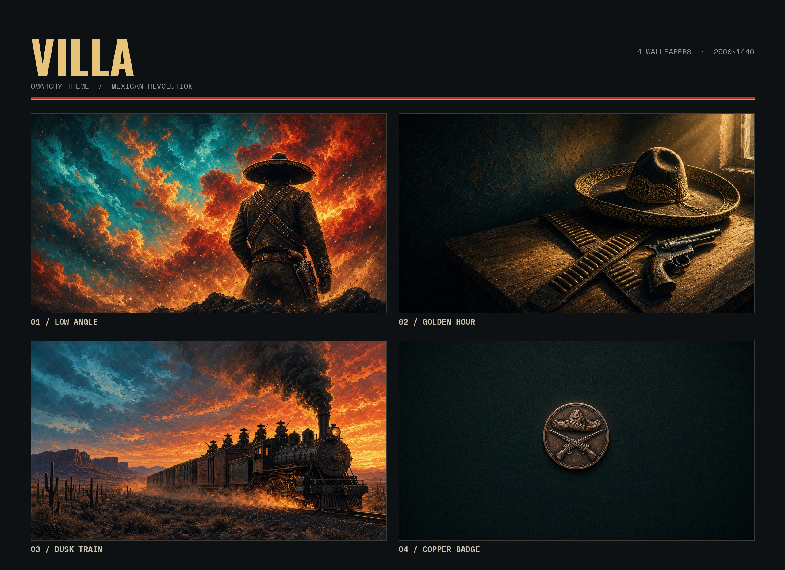

# Villa — an Omarchy theme

Cinematic Mexican Revolution poster art for [Omarchy](https://omarchy.org): a saturated teal sky against fiery orange, gold and red clouds, plus a dark copper-badge wallpaper for terminal work. Anonymous silhouettes only; no real person is depicted.



## Install

```bash
omarchy-theme-install https://github.com/rubengarciajr/omarchy-villa-theme
```

Or use **Install > Theme** in the Omarchy menu and paste the URL. Then pick **Villa** under **Style > Theme** (`Super + Ctrl + Shift + Space`). Cycle wallpapers with `Super + Ctrl + Space`.

## What's inside

Follows the current Omarchy 3 theme format: `colors.toml` drives every app config (Alacritty, Ghostty, Kitty, btop, Chromium, Hyprland, Hyprlock, Mako, SwayOSD, Walker, Waybar).

```
colors.toml     palette used to generate all app themes
neovim.lua      LazyVim + aether.nvim, same palette
icons.theme     Yaru-red folder icons
preview.png     theme preview (mockup)
gallery.png     the four wallpapers
backgrounds/
  1-low-angle-charro.png
  2-golden-hour-still-life.png
  3-dusk-train-chihuahua.png
  4-copper-badge.png
```

## Palette

| Role | Hex |
|---|---|
| background | `#0f1417` |
| foreground | `#e6d3a8` |
| accent | `#d9582b` |
| selection | `#1f4a50` |
| red / bright | `#b83a22` / `#e0583a` |
| green / bright | `#5f7a4e` / `#86a56c` |
| yellow / bright | `#d6a03c` / `#f0c560` |
| blue (teal) / bright | `#2a6f78` / `#3f9aa6` |
| magenta / bright | `#8a3a3a` / `#b5564f` |
| cyan / bright | `#3f8a8a` / `#6bc0bd` |

Wallpapers are AI-generated at 1280×720 and upscaled to 2560×1440.
